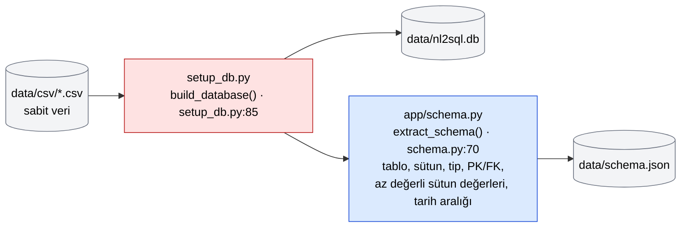
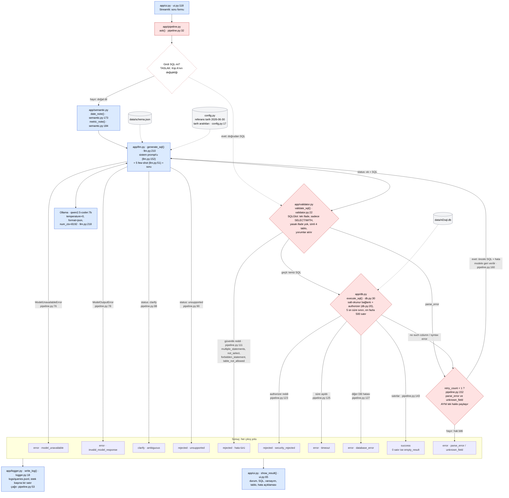

# Mimari

Diyagramlar [Mermaid](https://mermaid.js.org) ile yazıldı; GitHub dosyayı açınca çizer. PNG gerekirse
[mermaid.live](https://mermaid.live) üzerinden dışa aktarılır.

Renkler: **mavi** Kişi B (şema, LLM, semantik katman, arayüz, log), **kırmızı** Kişi A (veritabanı kurulumu, doğrulama,
çalıştırma, akış), **gri** veri / dosya. Kesikli çerçeve = **taslak** (henüz koda girmedi).
Kutulardaki `dosya:satır` referansları `sila/dokumanlar` dalındaki koda göredir.

## 1. Kurulum anı (bir kez)

## 2. Soru anı (her istek)

## Notlar

- **Yeniden deneme tek haktır.** `pipeline.py`'de tek bir `retry_count` sayacı var (`pipeline.py:35`,
  `config.MAX_RETRIES = 1` · `config.py:14`). Validator'ın `parse_error`'ı ile veritabanının `no such column` /
  `syntax error` hataları aynı yere düşer (`pipeline.py:152`). İlk denemede `parse_error`, ikincide `unknown_field`
  çıkarsa ikinci bir hak yoktur. Diğer hatalar (güvenlik reddi, timeout, model erişilemezliği, bozuk model cevabı)
  hiç yeniden denenmez.
- **Yalnızca temiz SQL çalışır.** Validator'ın yorumlardan arındırıp yeniden ürettiği SQL (`validator.py:40`)
  `execute_sql`'e gider (`pipeline.py:117`). Kullanıcının ya da modelin orijinal metni hiç çalışmaz.
- **İki savunma hattı.** Validator (SQLGlot) bir şeyi kaçırsa bile salt-okunur bağlantı (`db.py:32`) ve authorizer
  (`db.py:20`) yazmayı, ATTACH/PRAGMA'yı ve izinli 4 tablo dışını SQLite motoru seviyesinde reddeder.
- **Boş soru** LLM'e gitmeden `clarify · ambiguous` döner (`pipeline.py:66`, diyagramda gösterilmedi).
- **[A'NIN DEĞİŞİKLİĞİNDEN SONRA GÜNCELLENECEK]** "Girdi SQL mi?" dalı Kişi A'nın pipeline değişikliği `main`'e
  girene kadar taslaktır. Şu anki kodda bu dallanma yok: her girdi önce modele gider. Birleşince tespit koşulu
  `pipeline.py`'den okunacak, bu daldaki `parse_error`'ın modele gidip gitmediği diyagrama işlenecek ve satır
  numaraları yenilenecek.
